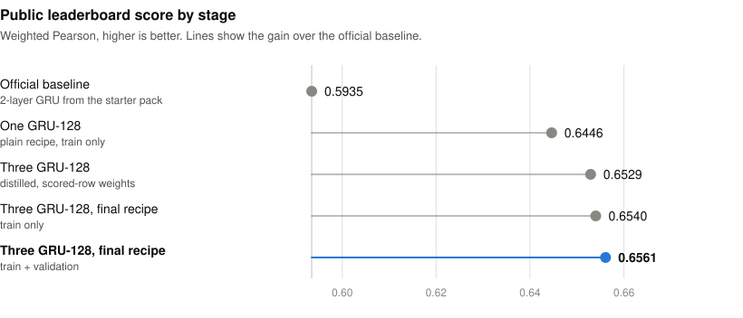
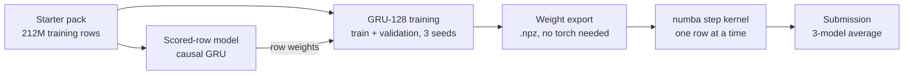

<div align="center">

# alpha-connectome-gru

**Streaming order-book forecasting with GRUs that run on a single CPU core.**

A complete pipeline for [Wunder Fund's Alpha Connectome challenge](https://wundernn.io/connectome):
training, distillation, analysis probes and a row-by-row inference kernel.

[](https://www.python.org/)
[](https://pytorch.org/)
[](https://numba.pydata.org/)
[](LICENSE)

[Results](#results) · [How it works](#how-it-works) · [Quick start](#quick-start) · [Repository layout](#repository-layout)

</div>

<br>

<table align="center">
  <tr>
    <td align="center"><b>0.6561</b><br><sub>public leaderboard score</sub></td>
    <td align="center"><b>Top 10%</b><br><sub>of about 5,800 participants</sub></td>
    <td align="center"><b>3 × GRU-128</b><br><sub>93k parameters each</sub></td>
    <td align="center"><b>33 minutes</b><br><sub>for 39.4M rows on one core</sub></td>
  </tr>
</table>

## The task

Each sequence is 20,000 rows of an anonymised limit-order-book stream with 112 features per row, covering two
instruments. For every row the model outputs two targets, `t0` and `t1`, which describe the future price move of
the first instrument.

Three constraints shape the solution:

- **Causal, row by row.** The scorer feeds one row at a time. A prediction can only use the rows seen so far.
- **One CPU core, 60 minutes.** The test set has 39.4 million rows, which leaves about 91 microseconds per row.
- **Weighted Pearson on a hidden subset of rows.** Targets are clipped to ±2, rows are weighted by the absolute
  clipped target, and only rows flagged `is_scored` count. The flag is known for the validation set only.

## Results

<p align="center">
  <picture>
    <source media="(prefers-color-scheme: dark)" srcset="assets/results-dark.svg">
    
  </picture>
</p>

Scores are weighted Pearson. "Holdout" is 20% of the validation sequences that were never used in training.

| Model | Validation | Public leaderboard |
| --- | :---: | :---: |
| Official baseline | 0.617 | 0.5935 |
| One GRU-128, plain recipe | 0.673 | 0.6446 |
| Three GRU-128, distilled, scored-row weights | 0.680 | 0.6529 |
| Three GRU-128, final recipe, train only | 0.682 | 0.6540 |
| Three GRU-128, final recipe, train + validation | 0.694 (holdout) | **0.6561** |

### What helped

- Weighting the loss by the estimated probability that a row is scored.
- Adding the validation sequences to training. They are closer in time to the test period.
- Smaller batches, stronger weight decay, chrono initialisation and per-sequence scale augmentation.

### What did not help

<details>
<summary>Ideas that landed within seed noise of the reference model on the holdout</summary>

<br>

- Wider or deeper GRUs, a sliding-window causal Transformer, a Highway head.
- Hand-made causal features with gradient boosting, and multi-scale EMA inputs to the GRU.
- Soft labels from an ensemble of earlier models, or from a teacher that reads the next 25 rows.
- Fine-tuning on validation with the true scoring mask, covariate-shift weights, stochastic weight averaging.
- Auxiliary heads that reconstruct past labels, and test-time adaptation of the output scale.

The scripts behind these checks are in `analysis/` and `modal/`.

</details>

## How it works



| Part | What it does | Where |
| --- | --- | --- |
| Model | Single-layer GRU with 128 hidden units, layer norm and a linear head, with explicit state | `wnn/model.py` |
| Training | Truncated back-propagation over whole sequences, loss weighted like the metric | `wnn/train.py` |
| Row weights | A causal GRU estimates the probability that a row is scored; the loss is weighted by it | `modal/mask_gru.py` |
| Recent data | Validation sequences are mixed into training, with a small holdout kept for model selection | `wnn/train.py --holdout-frac` |
| Initialisation | Chrono initialisation of the update gate for time scales up to 3,000 rows | `wnn/model.py` |
| Augmentation | One random input scale per sequence | `wnn/train.py --scale-aug` |
| Inference | numba kernel that steps the GRU one row at a time, with a numpy fallback | `wnn/infer.py` |
| Submission | Three models averaged, about 33 minutes on the scorer | `submit/solution.py` |

The inference kernel reproduces the PyTorch model to within 1e-5 for every model variant the trainer can produce.
`tests/test_parity.py` checks this, including non-finite inputs and the packed submission layout.

## Quick start

Requires Python 3.11 or newer.

```bash
git clone https://github.com/r34l-rudr44/alpha-connectome-gru.git
cd alpha-connectome-gru
pip install -r requirements.txt
```

Check that training and inference agree. This needs no data:

```bash
python tests/test_parity.py
```

Train a small model on synthetic data. It takes a few minutes on a CPU:

```bash
python -m wnn.train --synthetic --epochs 1 --out runs/smoke
```

### With the competition data

The competition data is not included and may not be redistributed. Registered participants can download the
starter pack from the competition site. Extract it and point the code at it:

```bash
export WNN_PACK_DIR=/path/to/wnn_connectome_starterpack
```

Without `WNN_PACK_DIR` the code looks in `data/wnn_connectome_starterpack`, then in `sample/`.

Train one model with the final recipe. `--weight-dir` is optional and takes the output of the mask model:

```bash
python -m wnn.train \
  --train $WNN_PACK_DIR/datasets/train.parquet --valid $WNN_PACK_DIR/datasets/valid.parquet \
  --out runs/gru128_s0 --hidden 128 --epochs 3 --batch 16 --wd 0.1 \
  --chrono 3000 --scale-aug 0.3 --amp --holdout-frac 0.2 --seed 0
```

Build a submission from one or more runs and measure its latency:

```bash
python make_submission.py runs/gru128_s0 runs/gru128_s1 runs/gru128_s2 --name ens3 --bench 2
```

`bench.py` reports latency in units of a bare GRU-128 kernel measured on the same machine. Submissions up to
about 5.8 units finished inside the 60-minute limit; three GRU-128 models are about 5 units.

### Running on Modal

The full training set is 212 million rows, so training ran on [Modal](https://modal.com) with one A10G GPU. One
model takes about six minutes. The jobs expect a Modal volume named `wnn-connectome-data`:

```bash
modal run modal/fetch_data.py --url <starter-pack URL>
modal run modal/mask_gru.py --tag causal
modal run modal/train_modal.py --name gru128_s0 --extra "--hidden 128 --epochs 3 --batch 16 --wd 0.1 --chrono 3000 --scale-aug 0.3 --amp --weight-dir /data/maskw2_causal --holdout-frac 0.2"
python export_run.py gru128_s0
```

## Repository layout

```
wnn/                 model, data loading, training, teachers and the inference kernel
submit/              solution.py, the entry point the scorer calls
modal/               jobs that run on Modal: data fetch, training, mask models, evaluation
analysis/            probes on predictions and data structure, CPU only
tests/               parity checks between training and inference code
assets/              figures used in this README
bench.py             latency and score check for a packed submission
export_run.py        fetch a finished run and export its weights
make_submission.py   build a submission zip from one or more runs
config.py            paths and constants
metric.py            the competition metric
```

## License

Released under the [MIT License](LICENSE). The competition data and starter pack belong to Wunder Fund and are not
covered by it.
